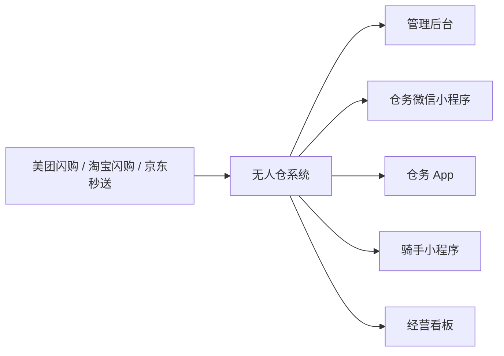

# 能力与架构

公开介绍只到「有哪些端、各管什么」。接口路径、库表和部署细节在商业交付里，不写在这个仓库。

## 使用端

| 端 | 谁用 | 做什么 |
|----|------|--------|
| 无人仓系统 | 全部端的后端 | 订单、商品、库存、货位、渠道、权限 |
| 管理后台 | 总部、仓管 | 仓库、商品、订单、库存、调拨、渠道、客服消息 |
| 仓务微信小程序 | 仓里的人 | 拣货、订单、库存、调拨、远程开门、到店订单 |
| 仓务 App | 仓里的人 | 与小程序同一套仓务，另有手机通知 |
| 骑手小程序 | 到仓取货的骑手 | 核验、开门、拣货拍照 |
| 经营看板 | 总部 | 今日经营、缺货、空货位、库存差异 |

仓务端的小程序和 App 是两套客户端，能力对齐，不能互相替代。

## 能力范围

| 模块 | 仓里用来做什么 |
|------|----------------|
| 订单进仓 | 美团闪购、淘宝闪购、京东秒送进同一个订单池，按状态拣货和跟踪 |
| 货位拣货 | 领单后按货位拣货；缺货走平台整单逆向 |
| 库存与货位 | 一格一位。库存跟着订单和调拨变 |
| 调拨补货 | 仓与仓之间出库、入库。待补的货位在工作台上能看见 |
| 到店购买 | 顾客扫码看这座仓在卖的商品，到店取货，或由仓配送。到店付款在确认完成时入账 |
| 商品铺货 | 总部商品落到各仓，再同步到已对接的平台店铺 |
| 客服消息 | 平台顾客消息进同一套会话，可以按在售商品回复 |
| 开门值守 | 远程开门、出入记录、监控设备 |
| 经营看板 | 今日的单和收入、缺货、空货位、各仓库存差异 |

门锁、摄像头、打印机要在现场安装。软件本身不代替这些硬件。

## 技术栈（公开层面）

| 部分 | 技术 |
|------|------|
| 后端 | Java，Spring Boot 2.7，MyBatis-Plus，Redis，RabbitMQ |
| 管理后台 | Vue 3，TypeScript，Vite，Ant Design Vue |
| 仓务 App | uni-app（Android / iOS） |
| 仓务小程序、骑手小程序 | 微信小程序 |
| 数据 | MySQL |

版本以交付时的合同和部署说明为准。本仓库不提供可编译的工程。

## 平台边界

三套平台的订单状态、商品编码和接口各不相同，不能当成一张表来套。对接使用购买方自己的商家资质和开发者应用。我们不把自有品牌的平台账号交给购买方。
